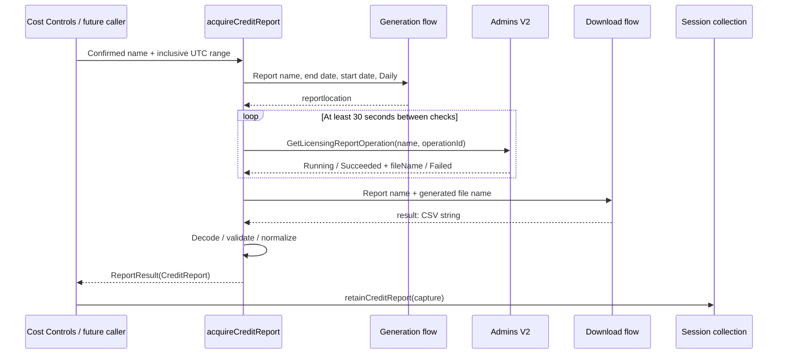

# Reusable Power Platform credit-report framework

This is the implementation guide for **Cost Controls > Power Platform credit
usage** (`#/cost-controls/power-platform`) and future consumers of its data.
The framework lives in `src/shared/credit-reports/`; consumers must import its
public `index.ts` barrel, **not** the Cost Controls feature or individual
generated services.

The current implementation acquires and imports Daily reports, retains multiple
captures in session memory, reconciles overlapping reported days, exposes pure
selectors, and exports the collection. It does **not** schedule background jobs,
persist to Dataverse/browser storage, or automatically populate dashboards.

## Architecture and ownership

| Module | Responsibility |
|---|---|
| `types.ts` | Report names, column-to-metric schemas, capture/row types, derived views, jobs and result types |
| `transport.ts` | Registered generation/download flows and Admins V2 polling; explicit alternate API transport |
| `client.ts` | Submission, operation validation, polling, timeout, cancellation, resume and parsing |
| `files.ts` | Complete-UTC-day presets, request-window validation, CSV/gzip parsing, file limits and capture creation |
| `store.ts` | Retained captures, compatibility latest-per-type snapshots, subscriptions and resumable jobs |
| `collection.ts` | Reported tenant scopes, requested-period matches and deterministic daily reconciliation |
| `selectors.ts` | Local row filtering and schema-neutral aggregation |
| `archive.ts` | Original-file ZIP, derived CSVs and provenance manifest |
| `index.ts` | Public consumer API |

`features/cost-controls/PowerPlatformCredits.tsx` owns user interactions:
confirmation, request/upload controls, capture/scope selection and downloads.
`CreditReportAnalysis.tsx` owns charts/tables and local filter state. Neither
component defines reconciliation or storage policy.

The store uses module-level immutable array replacements and
`useSyncExternalStore`. Snapshot getters return the same array until a write;
do not make a getter reconstruct an array on each read. There is no additional
app-wide React context.

## Acquisition lifecycle and flow contracts



The default path is **Power Platform for Admins V2 reporting**, through two
registered Power Automate adapters where SDK response handling requires them.
It does not use MAC/Graph or the generic HTTP wrapper.

### Generation: `PP-Request-Credit-Licensing-Report`

| Registered input | Meaning |
|---|---|
| `text` | `BillingDetailsPerEnvironment` or `FeatureDetailsPerResource` |
| `text_1` | Inclusive UTC end date, `YYYY-MM-DD` |
| `text_2` | Inclusive UTC start date, `YYYY-MM-DD` |
| `text_3` | `Daily` |

Output: **`reportlocation`**, a text initial operation URL, or failure text.
The flow must return the initial asynchronous location, not wait and return
only final `status`/`fileName`. An unsuccessful SDK result, blank output or
non-URL failure message is surfaced. Submission is never automatically retried:
an uncertain response may already have created a server job.

`client.ts` accepts validated operations on `api.powerplatform.com`, or the
Admins V2 `*.azure-apihub.net/apim/powerplatformadminv2/<connection>/...` route.
The report name must match and the operation ID must be safe. **Only the
operation ID is extracted**. The app never fetches the returned URL or changes
connections based on its contents.

### Polling: direct Admins V2

`GetLicensingReportOperation(name, operationId, "2024-10-01")` returns
`Running`, `Succeeded` or `Failed`. Success must include a file name.

The connector transport waits at least **30 seconds** before the first poll
and between running results. A longer exposed `Retry-After` is respected;
absent retry headers are allowed on this transport. Invalid exposed retry
metadata stops acquisition. The local timeout is two hours.

### Download: `PP-Download-Credit-Licensing-Report`

| Registered input | Meaning |
|---|---|
| `text` | Report name |
| `text_1` | Generated file name, including its server suffix |

Output: **`result`**, the CSV body as a JSON text output, not the HTTP envelope.
The SDK already decodes JSON string escapes. Do not blindly replace escaped
characters in the CSV; they can be legitimate field values.

The installed Code App SDK attempted to parse the direct action's `text/csv`
response as JSON and returned `Invalid response format` with no usable data.
The flow preserves the CSV in a JSON output so parsing can happen in the app.
A server name ending in `.gz` does not prove its returned body is compressed.
Gzip detection is by magic bytes; an uncompressed downloaded CSV loses the
misleading `.gz` suffix when saved.

The generation flow similarly preserves the operation location which the
direct generation SDK path did not expose reliably. These are runtime adapter
decisions, not a claim that the underlying connector cannot generate/download.
Reevaluate both adapters when the SDK or reporting API changes, with actual
response verification. Never hand-edit generated clients or installed SDK code.

### Results, cancellation and resume

`acquireCreditReport` returns `ReportResult<CreditReport>`: an explicit success
or an error with resumable job information and, where appropriate, diagnostics.
It **does not** insert its result into the store. Only retain successful results.

Use an `AbortSignal` and save `onJob` updates. Stopping or navigating away stops
local waiting; it does not cancel server generation. An in-flight SDK call is
not cancellable, so late results are discarded.

Resume with the original report type/range and saved operation ID or completed
file name. Resume never submits another generation request and may reference
historical dates outside the current new-request window. Terminal failed
operations cannot be resumed. Jobs are held separately, one per report type,
and disappear on reload; exporting captures does not export resumable jobs.

`createConnectorReportTransport(generate)` supplies the same polling/download
implementation with an injected generation function returning `{ location }`.
The explicit API transport remains an alternate internal adapter for typed
callers/tests, never an automatic fallback. Its retry-header requirements
differ from the connector's fixed minimum polling interval.

## Capture model, source and dates

A `CreditReport` is one **immutable captured file**:

| Field | Meaning |
|---|---|
| `id` | New capture UUID; importing the same file again creates another capture |
| `schemaVersion` | Capture model version, currently `1`; not the service API version |
| `name`, `granularity` | One supported report type and `Daily` |
| `source` | `connector`, `power-platform-api` or `upload` |
| `loadedAt` | Client retrieval/import timestamp, not service generation time |
| `requestedRange` | Original request bounds when known; generally absent on uploads |
| `observedRange` | Minimum/maximum dates actually present; `null` for header-only files |
| `columns`, `rows` | Original column names plus normalized rows with original `cells` |
| `fileName`, `original` | Saved name and exact received/imported `Blob` |

Normalized rows expose `date`, lowercased `environmentId`, `environmentName`,
numeric `first`/`second`, and all original string `cells`. Newline/quote-bearing
names and additional report columns survive ingestion.

**Three different concepts must stay distinct:**

- **Requested period:** which dates were asked for. It does not prove every
  environment/resource/date was returned.
- **Observed period/days:** which dates have rows. Min/max endpoints do not
  imply continuous coverage. Missing dates are unknown, not zero.
- **Retrieval time:** when this client loaded the file. Reports may lag by
  about a day; a newer import can contain older service data.

`defaultReportRange(now)` returns the previous 30 complete UTC days.
`reportRangePreset(30 | 7 | 1, now)` supports the editable request shortcuts.
**Last 24 hours means the last complete UTC day**, not rolling hourly data.
New requests are restricted to the previous 30 complete UTC days; all bounds
are inclusive. Manual edits switch the UI preset to Custom.

Report cells may use `YYYY-MM-DD` or midnight timestamps, including
`2026-11-01 00:00:00.0000000`. Normalize only valid midnight values. Request
dates remain strict `YYYY-MM-DD`; invalid calendar dates, non-midnight times
and nonzero fractional seconds are rejected rather than rounded.

## Retention and compatibility APIs

| API | Contract |
|---|---|
| `retainCreditReport(capture)` | Retain a capture and its original. An existing ID is updated in its existing position; new IDs append |
| `getCreditReportCaptures()` / `useCreditReportCaptures()` | Every retained capture in collection order |
| `removeCreditReportCapture(id)` | Remove one capture; reconciliation can reveal its older daily rows again |
| `clearCreditReports(name?)` | Remove all captures of a type, or all types when omitted |
| `getCreditReports()` / `useCreditReports()` | Compatibility view: newest loaded individual capture per type, **not** holistic data |
| `replaceCreditReport(capture)` | Legacy alias for `retainCreditReport`; updates the compatibility view without discarding history |
| `saveReportJob` / `useReportJobs` | Separate resumable acquisition state |

All storage is **in this running app's memory**. Navigation/remount preserves
it; reload, closing the player or starting another app instance does not.
There is no localStorage, IndexedDB, cross-tab sharing or Dataverse persistence.
Keeping the app open does not itself run daily collection.

Captures accumulate until explicitly removed or the session ends. The UI shows
the number of captures and total original-byte size, not total browser heap:
parsed strings, objects, derived views and ZIP buffers use additional memory.
There is no collection-wide eviction policy. For large collections, export and
remove older captures; this is not yet a durable data warehouse.

`findCoveringCreditReport(captures, name, range)` finds the newest non-upload
capture whose **requested** period includes the selected bounds. It powers
the duplicate-request notice and a View loaded action. It neither claims
verified coverage/freshness nor silently skips a new request. An explicitly
confirmed request can always ask the service again. Uploads are not treated as
evidence that a requested period has already been acquired.

## Reconciliation: newest loaded capture wins per reported UTC day

Call `reconcileCreditReports(captures, name, scopeKey)` for holistic analysis.
It returns a `ReconciledCreditReport`, or `undefined` if no captures of that
report type exist. An invalid scope, or omitting the scope when multiple scopes
exist, throws an actionable error.

### Reported tenant scopes

`creditReportScope(capture)` and `creditReportScopes(captures, name)` derive
scopes from the exact **`TenantID`** CSV column, trimming and lowercasing IDs.
A capture joins a reported tenant only if **every row has a nonempty ID and
all IDs match**. Unknown, partially populated, mixed-tenant and header-only
captures each receive their own `capture:<id>` scope.

Consequences:

- Different tenant claims and different report types never reconcile together.
- Two files without tenant IDs are not silently assumed to belong together.
- A header-only capture cannot erase earlier observed days or establish tenant
  identity from its request period.
- A matching uploaded `TenantID` allows reconciliation, but is a file claim,
  **not identity/completeness verification**. This mechanism is not an access
  control boundary. Do not use it as proof of which tenant the invoker owns.

The UI prefers known reported-tenant scopes, exposes the scope selector in
holistic mode, and keeps unknown/mixed files selectable separately. Support
for operator-verified provenance or additional schema aliases would require
an explicit future design, not a heuristic join.

### Algorithm

1. Select one report type and one scope.
2. Sort captures ascending by parsed `loadedAt`. Equal timestamps preserve
   collection order, so the later-added capture wins a tie. Updating the same
   capture ID does not change its collection position.
3. Group each capture's rows by normalized UTC date.
4. For each date actually present, replace the previous **entire row-set** of
   that day with the newer capture's row-set. Do not add overlapping captures
   and do not invent row identities for deduplication.
5. Keep older days not present in the newer capture. Sort resulting days
   ascending and record each day's winning capture ID.

Rows within a winning day's capture remain unchanged, including duplicates
already in that original file. This policy avoids cross-capture duplication;
it does not repair malformed business data or prove an uploaded day complete.

### Example: rolling 30 days plus daily collection

All captures below have the same report type and reported tenant.

| Capture | Loaded | Reported rows |
|---|---|---|
| A | Nov 2 | Oct 3 through Nov 1 |
| B | Nov 3 | Nov 2 |
| C | Nov 4 | Nov 3 |
| D | Nov 4, later | Corrected Nov 1 only |

The holistic view covers the **reported** days Oct 3 through Nov 3: A supplies
older days, D replaces all Nov 1 rows, B supplies Nov 2, C supplies Nov 3.
If A had two resources on Nov 1 and D has one, that day's second resource is
not kept as a stale extra row. If D has no Nov 2 rows, B's Nov 2 rows remain.
Deleting D restores A's Nov 1 rows. Original A/B/C/D files remain exportable.

When an older service report is imported today, today's import time can make
it win against an earlier-loaded download. Prefer individual-capture analysis
when investigating that distinction, or remove the unwanted capture. Never
label the reconciliation policy "newest server data wins".

### Derived view contract

`ReconciledCreditReport` shares analysis fields with `CreditReport`, but has
`source: "reconciled"`, `scopeKey`, `captureIds` and `daySources`.
`captureIds` includes all captures selected for that scope; `daySources`
identifies actual contributors and winners. Its `loadedAt` is the latest
selected capture's load time. `observedRange` is derived from winning rows.

It intentionally has **no `original`, `fileName` or requested period**.
It is a projection, not a newly captured file. Do not retain it in the capture
store or pass it off as an original. Its columns are the union of selected
capture columns, retaining their encountered order; absent optional cell values
export as empty strings, not invented zeros.

## Analysis and safe consumption math

| Report | `first` | `second` |
|---|---|---|
| `BillingDetailsPerEnvironment` | `CapacityPackCreditsConsumed` | `PayGoConsumedQuantity` |
| `FeatureDetailsPerResource` | `BilledCredits` | `NonBilledCredits` |

Environment billing is the first tab, default empty-state dataset and first
report acquired when requesting both. With existing captures the initial
selection prefers billing when available.

`selectReportRows(view, filter)` applies inclusive local date bounds,
environment ID and case-insensitive search across returned cell values.
`aggregateReportRows(rows, dimension)` groups by `date`, `environment`,
`resource`, `Feature` or `Product`. Resource keys include the environment ID:
the same solution bot ID can occur in multiple environments.

The same selectors accept individual captures and reconciled views. The UI's
date/environment/search filters affect charts, totals, rankings and inspected
rows, not acquisition, retention or exports. Clearing filters restores all
loaded dates. Grouped tables and raw rows are paginated.

**Do not change these invariants:**

- Never add the two report types together; they are different perspectives on
  usage, not independent piles of credits.
- `AllocatedCapacityPackCredits` is a daily snapshot, not consumption. Keep it
  in raw cells; do not sum it over dates as usage.
- Credits are not currency and no unit-price conversion is inferred.
- Missing dates, resources, reports and identities do not mean zero/deleted.
- Resource rankings can contain non-agent types. Inspect/filter `ResourceType`
  before claiming a ranking is "top agents".
- Preserve negative adjustments and finite decimal values. Aggregation uses
  JavaScript numbers, not an exact-decimal financial ledger; original numeric
  strings and bytes remain available. Overflow is surfaced as an error.

## Reusing data in another feature

Import from `../../shared/credit-reports` (adjust the relative prefix to your
feature), not from `features/cost-controls`. No new acquisition is needed to
read the session collection.

An imperative consumer can select a tenant scope and project environment usage:

```ts
import {
  aggregateReportRows, getCreditReportCaptures,
  reconcileCreditReports, selectReportRows,
} from "../../shared/credit-reports";

// scopeKey must come from an explicit creditReportScopes(...) selection.
export function billingByEnvironment(scopeKey: string, startDate: string, endDate: string) {
  const view = reconcileCreditReports(
    getCreditReportCaptures(), "BillingDetailsPerEnvironment", scopeKey,
  );
  if (!view) return { state: "not-loaded" as const };
  const rows = selectReportRows(view, { startDate, endDate });
  return {
    state: "ready" as const,
    groups: aggregateReportRows(rows, "environment"),
    observedRange: view.observedRange,
    daySources: view.daySources,
  };
}
```

A reactive dashboard/detail component can use `useCreditReportCaptures()` and
memoize reconciliation by `[captures, reportName, scopeKey]`, then filtering
by the local filter object. Render a not-loaded/choose-scope state explicitly.
Do not call acquisition in an effect just because a panel mounts, and do not
sum `getCreditReports()` or all captures to obtain holistic usage.

For environment groups/zones, join normalized environment IDs against the
appropriate shared inventory membership data **after** reconciliation. For a
resource detail, join by environment ID plus resource ID, not display name or
bot ID alone. Group membership is not embedded in these CSVs, and historical
membership cannot be inferred from today's inventory. Such enrichment,
dashboard tiles and detail-page wiring are future consumers, not implemented
by this framework.

## Collection ZIP and restoration limitations

`exportCreditReportArchive(captures)` returns a ZIP `Blob`. The UI passes **all
retained captures**, including other report types/scopes, regardless of current
analysis filters or selected capture.

```text
originals/
  001-<safe-original-file-name>
  002-<safe-original-file-name>
reconciled/
  BillingDetailsPerEnvironment-1.csv
  FeatureDetailsPerResource-1.csv
  ...
manifest.json
```

Original paths have unique numbered prefixes and sanitized names; they cannot
traverse out of the archive. Every original's bytes are preserved, including
actual gzip compression. Download-flow originals are the exact CSV body
received from that flow, not an HTTP envelope or a reconstruction of bytes the
flow did not return.

Derived CSVs are separate per report type **and scope**, contain winning rows,
and escape CSV commas, quotes and line breaks. They preserve original cell
strings and union additional columns. The archive uses uncompressed ZIP
entries to avoid synchronously recompressing large originals. Export builds
additional in-memory buffers; it is not a streaming archival service.

The manifest records export time, policy, capture IDs/source/load time,
requested/observed ranges, original entry paths and row counts. Every derived
entry records its report name, scope, selected capture IDs and
`daySources: { "<UTC date>": "<winning capture ID>" }`.

**ZIP import/automatic session restoration is not implemented.** Extract and
upload individual original CSV/gzip files if needed. Reimporting creates new
IDs and import timestamps; it does not restore original priority/provenance
from the manifest. A derived CSV is also ingestible if it meets the schema,
but will be an uploaded projection, not proof of its source captures.

Original and derived files can contain sensitive tenant information and
untrusted text cells. Export/share deliberately; importing/exporting is not
anonymization or spreadsheet-formula sanitization. Never commit real tenant
captures as fixtures.

## Validation and extension seams

Parser limits are **25 MiB per compressed and expanded file** and **200,000 data
rows per file**. Header-only files are valid. Required column names are
case-sensitive. Malformed CSV, duplicate/empty headers, invalid dates, missing
or nonfinite numeric fields, mismatched downloaded type and out-of-request
rows fail explicitly. All optional original columns are retained.

Tests:

| File | Focus |
|---|---|
| `shared/credit-reports/files.test.ts` | CSV/gzip/schema/date validation, exact originals, limits and selectors |
| `shared/credit-reports/client.test.ts` | Mocked acquisition, flow contracts, operation URLs, polling, cancellation, resume and failures |
| `shared/credit-reports/collection.test.ts` | Daily replacement, disjoint/absent days, load-time ties, tenant isolation, presets, compatibility store, ZIP bytes/quoting/provenance |
| `features/cost-controls/PowerPlatformCredits.test.tsx` | Billing-first requests, confirmation, presets/manual edits, import, scope modes, local filters, cache notice and exports |

From `PP-CoE-CodeApp`, run:

```powershell
npm run test:run -- src/shared/credit-reports/files.test.ts src/shared/credit-reports/client.test.ts src/shared/credit-reports/collection.test.ts src/features/cost-controls/PowerPlatformCredits.test.tsx
npm run lint
npx tsc --noEmit
npm run build
```

Mocked tests do not establish cloud generation, destination consent or
cross-tenant deployment. For authentication failures, verify invoker identity
and activate eligible PIM roles where required. For missing operation metadata,
inspect/resume rather than resubmitting. For missing file content, verify the
download flow's `result` output and existing filename before creating new jobs.
Safe shape/stage console diagnostics do not include report rows; avoid adding
raw CSV, tokens or connection URLs to logs.

Future Dataverse persistence should store **captures and provenance**, not only
an ever-growing summed table. Preserve schema version, tenant verification
status, capture ID/time, requested/observed periods, original-file references,
normalized rows and ordering policy. Hydrate validated captures into the shared
store and reuse the pure reconciler. Design retention, authorization, at-rest
storage, original service generation timestamps, exact-decimal requirements and
multi-user conflict rules explicitly before implementing scheduled collection.
Do not silently enable persistence or introduce a new global state provider.

Both registered flows must be included in the actual solution with their
logical references and invoker/dependency mappings intact. For authorized
publishing, follow [`solution/README.md`](../../solution/README.md); registration,
passing local tests or a successful CLI exit is not proof of a deployable
cross-tenant managed ZIP.
